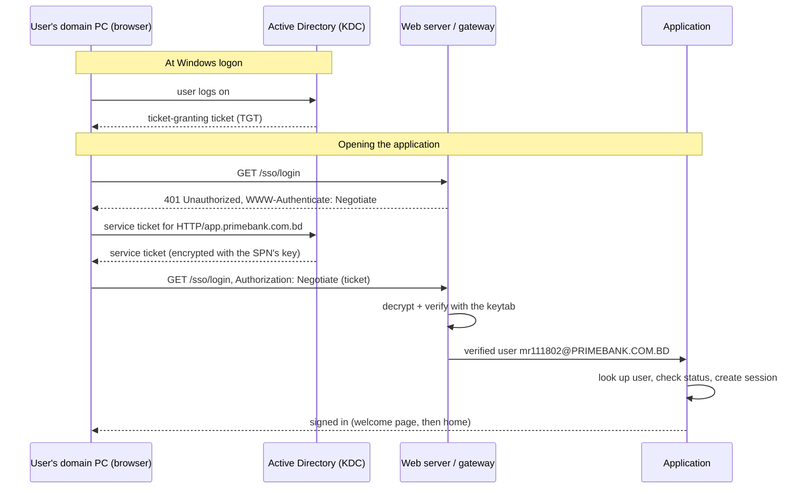

Contents

1. [Overview](#overview)
2. [How Kerberos SSO works](#how)
3. [What AD must provide](#ad)
4. [Integration patterns](#patterns)
5. [Pattern A: gateway](#gateway)
6. [Pattern B: in the application](#native)
7. [After authentication](#authz)
8. [User experience](#ux)
9. [Security requirements](#security)
10. [Testing](#testing)
11. [Troubleshooting](#trouble)
12. [Go-live checklist](#rollout)
13. [Reference implementation](#reference)

Prime Bank PLC · Information Technology Division

# Windows Single Sign-On with Kerberos: developer guide

How to let staff on domain-joined PCs open an internal web application already signed in with their Windows account, with no username or password and no ADFS, in PHP, Java, Python or .NET.

**Realm:** PRIMEBANK.COM.BD **Mechanism:** Kerberos via SPNEGO (HTTP Negotiate) **Proven on:** Sanction Screening (aml.primebank.com.bd)

## Overview

When a user logs on to a domain PC, Windows already holds a Kerberos ticket from Active Directory. A web application can accept that ticket instead of a password: the browser sends it automatically, the server verifies it with a key file from AD (a *keytab*), and the application learns the user's AD login name, for example `mr111802`.

### What you get

- No password prompt on domain PCs
- The user's verified AD account name
- No ADFS, no extra login server
- The server does not need to join the domain

### What stays the same

- Your application decides who may use it and with which role
- The normal login page for non-domain PCs and outside access
- Your own sessions, audit log and timeouts

**Terms used in this guide** **KDC**: the Kerberos service on the domain controllers. **SPN**: Service Principal Name, the Kerberos name of your web site, `HTTP/app.primebank.com.bd`. **Keytab**: a file holding the SPN's secret key, used by your server to check tickets. **SPNEGO / Negotiate**: how a ticket travels in HTTP, in the `Authorization: Negotiate …` header.

## How Kerberos SSO works



1. The server answers the first request with `401` and `WWW-Authenticate: Negotiate`. That is an invitation, not an error.
2. A browser that trusts the site asks AD for a service ticket for `HTTP/<host name>`, built from the host name in the address bar, and repeats the request with it.
3. The server verifies the ticket locally with the keytab. It does not call AD for each login.
4. The verified name (`user@REALM`) is handed to the application, which decides whether that user may use it.
5. A browser without a ticket (non-domain PC, outside the bank) cannot answer the 401; the application must then show its normal login page.

## What AD must provide

Ask the AD, network and PKI teams for the following, once per application. Replace `app.primebank.com.bd` and `svc-app-web` with your application's names.

| Item | Detail | Why |
| --- | --- | --- |
| DNS **A record** | `app.primebank.com.bd` → server IP. Not a CNAME. | Browsers build the SPN from the name; a CNAME can make them ask for a different SPN. |
| Service account | `svc-app-web`: password never expires, AES-256 enabled, cannot be delegated, no interactive logon | Owns the SPN and its key. |
| SPN | `setspn -S HTTP/app.primebank.com.bd PRIMEBANK\svc-app-web` | The Kerberos name of the site. Must exist exactly once in the forest. |
| Keytab | `ktpass … -crypto AES256-SHA1`, handed over securely | Lets the server verify tickets. Equivalent to a password. |
| Browser policy (GPO) | Site in the Local intranet zone; Chrome/Edge `AuthServerAllowlist`; Firefox `network.negotiate-auth.trusted-uris` | Browsers only send tickets to sites they are told to trust. |
| Proxy bypass | The host bypasses the web proxy, like other intranet sites | Treated as an intranet site; no proxy authentication in the way. |
| TLS certificate | For the host name, from the bank CA | Tickets and session cookies must travel over HTTPS. |
| Time sync (NTP) | Server time synchronised with the domain controllers | Kerberos rejects tickets with more than 5 minutes clock skew. |

Windows (AD admin)

```
setspn -S HTTP/app.primebank.com.bd PRIMEBANK\svc-app-web
Set-ADUser svc-app-web -KerberosEncryptionType AES256 -AccountNotDelegated $true -PasswordNeverExpires $true
ktpass -princ HTTP/app.primebank.com.bd@PRIMEBANK.COM.BD -mapuser PRIMEBANK\svc-app-web ^
       -crypto AES256-SHA1 -ptype KRB5_NT_PRINCIPAL -pass * -out app-web.keytab
```

**One SPN, one account.** If the same SPN is registered on two accounts, every ticket fails. Always use `setspn -S` (it refuses duplicates) and check with `setspn -Q HTTP/app.primebank.com.bd`. Running `ktpass` again changes the account password: the old keytab stops working immediately.

### Worked example: the request sent for Sanction Screening

This is the exact request given to the AD team for Sanction Screening. Copy it for your application and change the host name, IP and account name.

| Activity | Request |
| --- | --- |
| DNS creation | A record `thinkai.primebank.com.bd` → `192.168.202.168`. **Note:** it must be an A record, not a CNAME. |
| Service account creation | Account name `svc-snc-web`. Password set to never expire, and enable **"This account supports Kerberos AES 256 bit encryption"**. |
| SPN registration | `setspn -S HTTP/thinkai.primebank.com.bd PRIMEBANK\svc-snc-web` |
| Keytab generation | `ktpass -princ HTTP/thinkai.primebank.com.bd@PRIMEBANK.COM.BD -mapuser PRIMEBANK\svc-snc-web -crypto AES256-SHA1 -ptype KRB5_NT_PRINCIPAL -pass * -out snc-web.keytab` Please hand over the keytab file securely once generated. |

Request text (ready to send)

```
DNS Creation:
A Record: thinkai.primebank.com.bd [192.168.202.168]
Note: It must be an A record, not a CNAME.

Service Account Creation:
Account Name: svc-snc-web
Settings: Password set to never expire, and enable "This account supports Kerberos AES 256 bit encryption".

SPN Registration:
setspn -S HTTP/thinkai.primebank.com.bd PRIMEBANK\svc-snc-web

Keytab Generation:
ktpass -princ HTTP/thinkai.primebank.com.bd@PRIMEBANK.COM.BD -mapuser PRIMEBANK\svc-snc-web -crypto AES256-SHA1 -ptype KRB5_NT_PRINCIPAL -pass * -out snc-web.keytab
Please hand over the keytab file securely once generated.
```

The browser policy, proxy bypass, TLS certificate and time synchronisation from the table above are requested the same way, for the same host name.

## Integration patterns

There are two ways to check the ticket. Both end the same way: your application receives a verified `user@REALM` and applies its own rules.

Recommended

### A. Gateway in front

A small Apache server with `mod_auth_gssapi` checks the ticket and forwards only the SSO login request to your application, with the verified user. The application contains no Kerberos code.

- Works for any language
- One proven, maintained component
- Kerberos libraries stay out of the app

Alternative

### B. Inside the application

The application's framework checks the ticket itself (Spring Security Kerberos, ASP.NET Core Negotiate, Python `pyspnego`, IIS Windows Authentication).

- No extra component
- Natural on IIS / Windows servers
- Needs Kerberos libraries and the keytab in the app runtime

In both patterns, protect **only one URL** (for example `/sso/login`) with Kerberos. Everything else uses the application's own session, exactly as after a password login.

## Pattern A: gateway in front (any language)

Apache with `mod_auth_gssapi` (Debian/Ubuntu: `libapache2-mod-auth-gssapi`; RHEL: `mod_auth_gssapi`) offers only Kerberos, verifies the ticket and passes the user on. Your main web server sends only `/sso/login` to it.

Apache (gateway)

```
Listen 8081
<VirtualHost *:8081>
    # Browser without a ticket: the 401 page sends it to the normal login page.
    ErrorDocument 401 /sso-fallback.html

    <Location "/sso/login">
        AuthType GSSAPI
        AuthName "Single Sign-On"
        GssapiCredStore keytab:/etc/sso/app-web.keytab
        # Kerberos only (never NTLM), never a password prompt, no retry loop
        # after a failure, and keep the full user@REALM name.
        GssapiAllowedMech krb5
        GssapiBasicAuth Off
        GssapiNegotiateOnce On
        GssapiLocalName Off
        Require valid-user

        # Pass the verified user to the application. Unset first, so a
        # client can never supply these headers itself.
        RequestHeader unset X-SSO-User
        RequestHeader unset X-SSO-Secret
        RequestHeader set   X-SSO-User   "%{REMOTE_USER}s"
        RequestHeader set   X-SSO-Secret "${SSO_GATEWAY_SECRET}"
    </Location>
    ProxyPass        "/sso/login" "http://app-backend:8080/sso/login"
    ProxyPassReverse "/sso/login" "http://app-backend:8080/sso/login"
</VirtualHost>
```

nginx (main web server)

```
# Only the SSO login URL goes to the Kerberos gateway.
location = /sso/login {
    proxy_pass http://sso-gateway:8081;
    proxy_set_header Host $http_host;
    proxy_set_header X-Real-IP $remote_addr;
    # Never let a client send the identity headers through:
    proxy_set_header X-SSO-User "";
    proxy_set_header X-SSO-Secret "";
}
```

**The rule that matters most.** The application must accept `X-SSO-User` *only* together with the correct `X-SSO-Secret`, and only on the SSO login URL. Without the secret, anyone who can reach the application could claim to be any user. Some web servers also copy an unverified Basic-auth user name into `REMOTE_USER` (nginx's default `fastcgi_params` does), so never trust `REMOTE_USER` on its own either.

### Reading the user in the application

PHP

```
// /sso/login
$secret = trim(file_get_contents('/etc/app/sso-gateway.secret'));
$got    = $_SERVER['HTTP_X_SSO_SECRET'] ?? '';
$user   = $_SERVER['HTTP_X_SSO_USER'] ?? '';
if ($secret === '' || !hash_equals($secret, $got)) {
    header('Location: /login?form=1'); exit;          // not from the gateway
}
if (!preg_match('/^([A-Za-z0-9._-]{1,64})@PRIMEBANK\.COM\.BD$/i', $user, $m)) {
    header('Location: /login?form=1'); exit;          // wrong realm / format
}
$username = strtolower($m[1]);                        // e.g. mr111802
// -> section 7: look up the user, check status, start the session
```

Java (Spring MVC)

```
@GetMapping("/sso/login")
public String ssoLogin(@RequestHeader(value = "X-SSO-User", required = false) String user,
                       @RequestHeader(value = "X-SSO-Secret", required = false) String got,
                       HttpServletRequest request) {
    if (got == null || !MessageDigest.isEqual(secret.getBytes(UTF_8), got.getBytes(UTF_8))) {
        return "redirect:/login?form=1";               // not from the gateway
    }
    Matcher m = Pattern.compile("^([A-Za-z0-9._-]{1,64})@PRIMEBANK\\.COM\\.BD$",
                                Pattern.CASE_INSENSITIVE).matcher(user == null ? "" : user);
    if (!m.matches()) return "redirect:/login?form=1";
    String username = m.group(1).toLowerCase(Locale.ROOT);
    // -> section 7: look up the user, check status, create the session
    return "redirect:/home";
}
```

Python (Flask)

```
import hmac, re
from flask import request, redirect

SECRET = open("/etc/app/sso-gateway.secret").read().strip()
PRINCIPAL = re.compile(r"^([A-Za-z0-9._-]{1,64})@PRIMEBANK\.COM\.BD$", re.I)

@app.get("/sso/login")
def sso_login():
    if not hmac.compare_digest(SECRET, request.headers.get("X-SSO-Secret", "")):
        return redirect("/login?form=1")                # not from the gateway
    m = PRINCIPAL.match(request.headers.get("X-SSO-User", ""))
    if not m:
        return redirect("/login?form=1")
    username = m.group(1).lower()
    # -> section 7: look up the user, check status, create the session
    return redirect("/home")
```

C# (ASP.NET Core)

```
app.MapGet("/sso/login", (HttpContext ctx) =>
{
    var got  = ctx.Request.Headers["X-SSO-Secret"].ToString();
    var user = ctx.Request.Headers["X-SSO-User"].ToString();
    if (!CryptographicOperations.FixedTimeEquals(Encoding.UTF8.GetBytes(secret), Encoding.UTF8.GetBytes(got)))
        return Results.Redirect("/login?form=1");       // not from the gateway
    var m = Regex.Match(user, @"^([A-Za-z0-9._-]{1,64})@PRIMEBANK\.COM\.BD$", RegexOptions.IgnoreCase);
    if (!m.Success) return Results.Redirect("/login?form=1");
    var username = m.Groups[1].Value.ToLowerInvariant();
    // -> section 7: look up the user, check status, sign in with cookie auth
    return Results.Redirect("/home");
});
```

## Pattern B: inside the application

The framework verifies the ticket. The keytab must be readable by the application process (and only by it), and the Kerberos client libraries must be installed (Linux: MIT krb5).

/etc/krb5.conf (Linux servers)

```
[libdefaults]
    default_realm = PRIMEBANK.COM.BD
    dns_lookup_kdc = true
    rdns = false
    permitted_enctypes = aes256-cts-hmac-sha1-96 aes128-cts-hmac-sha1-96
```

Spring Security Kerberos (`org.springframework.security.kerberos:spring-security-kerberos-web`, a version matching your Spring Security). Protect only `/sso/login`; the rest of the app uses its normal login.

Java

```
@Configuration
public class SsoConfig {

    @Bean
    SunJaasKerberosTicketValidator ticketValidator() {
        SunJaasKerberosTicketValidator v = new SunJaasKerberosTicketValidator();
        v.setServicePrincipal("HTTP/app.primebank.com.bd@PRIMEBANK.COM.BD");
        v.setKeyTabLocation(new FileSystemResource("/etc/app/app-web.keytab"));
        return v;
    }

    @Bean
    KerberosServiceAuthenticationProvider kerberosProvider(UserDetailsService appUsers) {
        KerberosServiceAuthenticationProvider p = new KerberosServiceAuthenticationProvider();
        p.setTicketValidator(ticketValidator());
        p.setUserDetailsService(appUsers);   // your DB lookup (section 7)
        return p;
    }

    @Bean
    AuthenticationManager authenticationManager(KerberosServiceAuthenticationProvider p) {
        return new ProviderManager(p);
    }

    @Bean
    SecurityFilterChain ssoChain(HttpSecurity http, AuthenticationManager am) throws Exception {
        SpnegoAuthenticationProcessingFilter spnego = new SpnegoAuthenticationProcessingFilter();
        spnego.setAuthenticationManager(am);
        http.securityMatcher("/sso/login")
            .authorizeHttpRequests(a -> a.anyRequest().authenticated())
            .exceptionHandling(e -> e.authenticationEntryPoint(new SpnegoEntryPoint("/login?form=1")))
            .addFilterBefore(spnego, BasicAuthenticationFilter.class);
        return http.build();
    }
}
// The UserDetailsService receives "mr111802@PRIMEBANK.COM.BD": strip and check the
// realm, load the user from your table, throw UsernameNotFoundException if absent.
```

#### IIS on a domain-joined Windows server

- Enable **Windows Authentication** on the SSO path, disable Anonymous there.
- Providers: keep **Negotiate** only (remove NTLM, per bank policy).
- Register the SPN on the application pool's account (or keep the default with Kernel-mode authentication and register it on the server's computer account).
- The user arrives as `User.Identity.Name` = `PRIMEBANK\mr111802`.

#### ASP.NET Core (Kestrel, Windows or Linux)

C#

```
// Program.cs  (package: Microsoft.AspNetCore.Authentication.Negotiate)
builder.Services.AddAuthentication(CookieAuthenticationDefaults.AuthenticationScheme)
    .AddCookie(o => o.LoginPath = "/login")
    .AddNegotiate();                          // Kerberos for /sso/login only

var app = builder.Build();
app.UseAuthentication();
app.UseAuthorization();

app.MapGet("/sso/login", async (HttpContext ctx) =>
{
    var result = await ctx.AuthenticateAsync(NegotiateDefaults.AuthenticationScheme);
    if (!result.Succeeded) { await ctx.ChallengeAsync(NegotiateDefaults.AuthenticationScheme); return; }
    var name = result.Principal!.Identity!.Name;  // Linux: mr111802@PRIMEBANK.COM.BD, Windows: PRIMEBANK\mr111802
    // -> section 7: check the user, then ctx.SignInAsync(cookie scheme, appPrincipal)
    ctx.Response.Redirect("/home");
});
// Linux: install MIT krb5 (libgssapi-krb5-2) and set KRB5_KTNAME=/etc/app/app-web.keytab
```

Package `pyspnego` (with `gssapi`), MIT krb5 installed, and `KRB5_KTNAME=/etc/app/app-web.keytab` in the process environment.

Python (Flask)

```
import base64, spnego
from flask import Flask, request, Response, redirect

@app.get("/sso/login")
def sso_login():
    auth = request.headers.get("Authorization", "")
    if not auth.startswith("Negotiate "):
        return Response(status=401, headers={"WWW-Authenticate": "Negotiate"},
                        response=FALLBACK_HTML)  # page that sends to /login?form=1
    ctx = spnego.server(service="HTTP", protocol="kerberos")   # Kerberos only, no NTLM
    try:
        ctx.step(base64.b64decode(auth.split(" ", 1)[1]))
    except spnego.exceptions.SpnegoError:
        return redirect("/login?form=1")
    if not ctx.complete:
        return redirect("/login?form=1")
    principal = ctx.client_principal          # "mr111802@PRIMEBANK.COM.BD"
    # -> section 7: check realm and user, create the session
    return redirect("/home")
```

Django: put the Apache gateway (pattern A) in front, or set `REMOTE_USER` from it and use `RemoteUserMiddleware` with a custom backend that applies section 7.

For PHP, use **pattern A**, or run the application itself under Apache with `mod_auth_gssapi` on the SSO path and read `$_SERVER['REMOTE_USER']` there (set by Apache after verification). The PECL `krb5` extension also works but is rarely packaged and harder to maintain.

**PHP-FPM behind nginx:** nginx's default `fastcgi_params` sets `REMOTE_USER` from an unverified Basic-auth header. Only trust `REMOTE_USER` when it comes from Apache on the protected path, and add a gateway secret as in pattern A.

## After authentication: the application decides

Kerberos proves *who* the user is. It does not say whether they may use your application. Apply these rules on every SSO login:

1. **Check the realm.** Accept only `@PRIMEBANK.COM.BD`. Anything else goes to the login page.
2. **Normalise the name.** Strip the realm, compare case-insensitively: `MR111802@PRIMEBANK.COM.BD` → `mr111802`.
3. **Look the user up in your own user table.** Not found → "Unauthorized Access – you don't have permission to access this application". Inactive, unverified or pending → "Access denied" with the reason and who to contact.
4. **Create the session exactly as after a password login**: same roles, branch, flags, single-session rule. Renew the session ID at login.
5. **Write the audit log** as for a password login (the bank's inactivity reports rely on the "login success" entry), noting that the method was SSO.

Keeping one shared "finish login" routine for both password and SSO logins guarantees they behave identically.

## User experience

### Login decision flow

What happens when a user opens the login page. Every application implementing SSO should follow the same flow, so users get the same behaviour everywhere.

Flow

```
User opens  https://app.primebank.com.bd/login
  │
  ├─ already signed in ─────────────────────────────────────────► home
  │
  ├─ SSO on + internal network + no ?form / ?logout / ?expired ──► /sso/login  (Kerberos-protected)
  │     │
  │     ├─ browser sends a ticket (domain PC) → user, e.g. mr111802@PRIMEBANK.COM.BD
  │     │     → realm checked, name normalised (mr111802)
  │     │     → look up in the application's own user table
  │     │         ├─ not found ──────────────► "Unauthorized Access" + link to the password login
  │     │         ├─ inactive / unverified /
  │     │         │  pending verification ───► "Access denied" + reason, contact IT User admin Team
  │     │         └─ active ─────────────────► same login as the password form
  │     │                                       (session, roles, branch, single-session rule,
  │     │                                        audit "login success (SSO)")
  │     │                                       → "Single Sign-On enabled" page → home
  │     │
  │     └─ no ticket (non-domain PC / not signed in to AD) ──► login page (password + OTP)
  │
  ├─ from outside / through the internet-facing proxy (DMZ) ──► login page (password + OTP)
  │
  ├─ after Sign out   (?logout=1)  ──► "You are logged out – click here to login again"
  │                                     (no automatic SSO; the link starts a normal sign-in)
  │
  └─ after idle timeout (?expired=1) ─► login page with "Your session expired" (no automatic SSO)
```

In Sanction Screening the same flow uses `/index.php/signin` and `/index.php/sso/negotiate`; sign-out and timeout both go to a configurable address (`snc_signout_url`).

### What the user sees

| Situation | What the user should see |
| --- | --- |
| Domain PC, valid user | Opening the site signs in automatically. Optional: a short "Single Sign-On enabled – signed in with your Windows account" page with a progress indicator, then home. |
| No ticket (non-domain PC, outside the bank) | The normal login page. No error, no browser password pop-up. |
| Valid AD account, no application account | "Unauthorized Access" with a link to the username/password login (not back to SSO, which would only repeat the message). |
| Sign out | "You are logged out – click here to login again". The page after sign-out must **not** start SSO automatically, or the user is signed straight back in. Use a flag such as `/login?logout=1`. |
| Idle timeout | Session ended after N minutes without activity; the login page explains why (`?expired=1`), again without automatic SSO. |
| Wants another account | A "Sign in with username and password" link to `/login?form=1`. |

The automatic attempt itself is simple: when an anonymous user opens the login page without `form`, `logout` or `expired` flags, and is on the internal network, redirect to `/sso/login`. Don't try SSO for users coming through the internet-facing reverse proxy.

## Security requirements

- [ ] Identity accepted only from the verification step: gateway secret checked in constant time, or framework-verified principal. Never from a client-controlled header or a bare `REMOTE_USER`.
- [ ] Kerberos only. No NTLM, no Basic fallback (no password ever travels to the server).
- [ ] Realm checked; user name validated against a strict pattern before any database query.
- [ ] HTTPS on the SSO URL and the whole application; session cookie `Secure`, `HttpOnly`, `SameSite=Lax`.
- [ ] Keytab readable only by the verifying process (e.g. `root:www-data 640`), outside the web root and out of source control; rotated yearly or if exposed.
- [ ] Service account: AES-256 only, "cannot be delegated", no interactive logon, password in the vault.
- [ ] Only the SSO URL is Kerberos-protected; the internal path to it cannot be reached from outside.
- [ ] Successful and refused SSO logins written to the audit log with user, time and source IP.
- [ ] The password login keeps working (and keeps its own AD password check) as fallback and for emergency access.

## Testing

### On a domain PC

Windows command prompt

```
klist purge
:: open https://app.primebank.com.bd in Edge or Chrome, then:
klist | findstr /i HTTP
:: expected: Server: HTTP/app.primebank.com.bd @ PRIMEBANK.COM.BD
```

### From a Linux test host (or the server itself)

Shell

```
kinit someuser@PRIMEBANK.COM.BD
curl -i --negotiate -u : https://app.primebank.com.bd/sso/login     # expect 200/302, not 401
klist -k -e /etc/app/app-web.keytab                                 # principals and AES-256 keys
```

### Without the bank's AD

A Samba AD domain controller in a container gives a complete test domain (for example `SNCTEST.LOCAL`): users, a service account, SPN and keytab export with the same steps as the AD team. A client container with `kinit` and `curl --negotiate` then tests every case automatically. Keep it on an internal network only and never join bank PCs to it.

| Test case | Expected |
| --- | --- |
| No ticket | `401` with `WWW-Authenticate: Negotiate`, then login page |
| Valid ticket, active user | Signed in; protected pages return 200 |
| Valid ticket, user not in the application | Unauthorized Access page |
| Valid ticket, inactive user | Access denied with reason |
| Sign out | Logged-out page; no automatic SSO |
| Forged identity header without secret | Refused (login page) |

## Troubleshooting

| Symptom | Likely cause | Fix |
| --- | --- | --- |
| Login page every time; server log shows only `401`, never a retry | Browser does not trust the site | Intranet zone / `AuthServerAllowlist` GPO; check `chrome://policy` |
| Works in one browser, not another | Policy missing in that browser; Chrome follows CNAMEs | Add the policy; use an A record or Chrome `DisableAuthNegotiateCnameLookup` |
| Chrome stops trying after one failure | Chrome remembers a failed Negotiate for the site | Restart Chrome after fixing the cause |
| `klist` shows no `HTTP/…` ticket | SPN missing, wrong name, or duplicated | `setspn -Q HTTP/app…` must return exactly one account |
| Token in the request starts with `TlRMTVNT` | Browser fell back to NTLM because Kerberos failed | Fix the SPN / name; the server must reject NTLM |
| Server log: "Decrypt integrity check failed" / `KRB_AP_ERR_MODIFIED` | Keytab does not match the account's current key (password changed, ktpass re-run) | Export a new keytab; check `kvno` |
| `KRB_AP_ERR_SKEW` | Server clock off by more than 5 minutes | NTP to the domain controllers |
| Works with the host name, not with the IP | Kerberos needs the host name the SPN was made for | Always use the DNS name |
| Password pop-up appears | Basic or NTLM offered by the server | Offer Negotiate (Kerberos) only |
| Signed in, then immediately back to login | Session cookie lost or rejected (domain, path, `Secure` over HTTP) | Check the `Set-Cookie` on the SSO response |

## Go-live checklist

- [ ] AD items delivered: A record, service account, SPN (unique), keytab, GPO, proxy bypass, certificate, NTP.
- [ ] SSO behind a configuration switch, off by default; can be turned off without a deployment.
- [ ] All test cases in section 10 pass in a test domain and on a pilot domain PC.
- [ ] Pilot with a small AD group first; password login still available.
- [ ] Keytab location, owner, permissions and rotation date documented; restart/rollback steps written down.
- [ ] Monitoring: SSO successes and refusals visible in the audit log.

## Reference implementation

Sanction Screening (`https://aml.primebank.com.bd`, PHP on Docker) uses pattern A and can serve as a working example:

| Part | Where |
| --- | --- |
| Kerberos gateway (Apache + mod_auth_gssapi) | `docker/sso/` – Dockerfile, `apache-sso.conf`, fallback page |
| Route to the gateway | `docker/sso/nginx-location.conf` |
| SSO controller (secret, realm, user checks) | `legacy/application/controllers/sso.php` |
| Shared "finish login" for password and SSO | `legacy/application/libraries/Snc_login_trait.php` |
| Welcome, logged-out, unauthorized pages | `legacy/application/views/pages/signin/index.php` |
| Idle timeout | `app/Controllers/LegacyGateway.php` |
| Setup and test domain | `scripts/sso-setup.sh`, `scripts/sso-testdc.sh`, `scripts/sso-vps-test.sh` |

Contact the Sanction Screening application team for access to the code and the AD activity list used for it.

Prepared by the Sanction Screening application team, Information Technology Division, Prime Bank PLC. Internal use. Do not paste keytabs, passwords or gateway secrets into tickets, chats or e-mail.